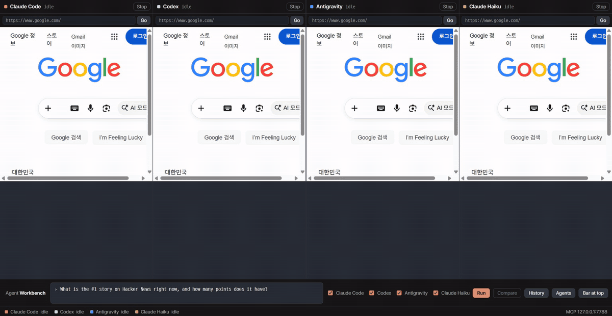
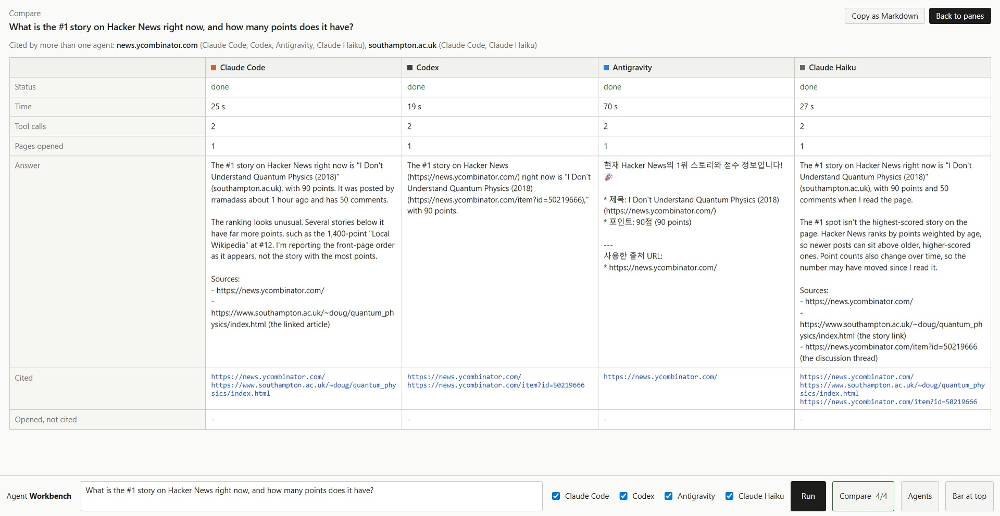
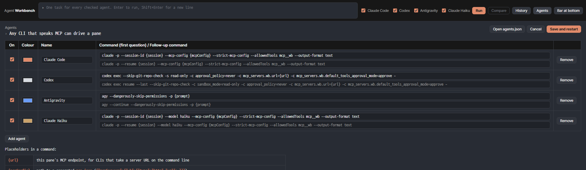

# Agent Workbench

**One desktop app. Any CLI agents you like. Each one drives its own browser, side by side, and you watch every click.**



Agent Workbench puts AI agents next to each other: Claude Code, Codex and Antigravity out of the box, plus any other CLI or model you add. Every agent gets its own Chromium pane, exposed to it as a small MCP server. Type one task, send it to all three, and compare what each one found and where it found it.

- **Its own browser per agent, with a cookie jar you choose.** Every pane starts clean: nothing saved, nothing carried over from the last run. Switch a pane to a named profile such as "My logins" when an agent should use a site you signed in to; panes on the same profile share it. The pane shows which sites have set session cookies, and one click wipes them.
- **You see everything.** Every tool call (`navigate`, `read_page`, `click`, `type` …) shows up live under the pane.
- **Compare board with an agreement line.** When the agents finish, one click lines up every answer side by side with time, tool calls, pages visited and the URLs each one cited. Numbers, dates and versions are pulled out of the answers and matched across agents, so the board opens with `Agreed by all 4: v24.22.1, 2026-10-21` or `Differs: 94 points (Claude Code, Codex) vs 93 points (Antigravity)`. One button sends the disagreement to an agent of your choice to verify in its browser.
- **Follow-up questions.** Each pane keeps its CLI session, so "and the previous LTS?" goes back into the same conversation (`claude --resume`, `codex exec resume`, `agy --continue`). Ask all agents at once, or one agent from its column on the board.
- **History and export.** Every run is saved on your machine and can be reopened or run again. The board exports as a Markdown file ready for your notes.
- **Bring your own agents.** Agents are command lines in `agents.json`. Add another CLI, or the same CLI with a different model (`claude --model haiku`), from the Agents screen. Each gets its own pane.
- **Risky clicks wait for you.** Buttons that look like submit, pay, send, post or delete pause the agent and show an approval card. Password fields are refused outright.
- **Uses the subscriptions you already have.** The app launches the official CLIs (`claude`, `codex`, `agy`), so there are no API keys to paste and no extra billing.
- **Local only.** The MCP server listens on `127.0.0.1`. Nothing outside your machine can drive the panes.

> Status: v0.2, early. Tested on Windows 11 with Claude Code 2.1, Codex CLI 0.163 and Antigravity CLI 1.4. macOS should work but is untested.



## How it works

```
 you ──task──▶ Agent Workbench (Electron)
                 ├─ spawns  claude -p   ──MCP──▶ http://127.0.0.1:7788/mcp/claude ─▶ pane 1 (Chromium)
                 ├─ spawns  codex exec  ──MCP──▶ http://127.0.0.1:7788/mcp/codex  ─▶ pane 2 (Chromium)
                 └─ spawns  agy -p      ──MCP──▶ http://127.0.0.1:7788/mcp/agy    ─▶ pane 3 (Chromium)
```

Each pane is an Electron `WebContentsView`. The app hosts a stateless Streamable HTTP MCP server, with one URL per pane, so an agent can only ever reach its own browser.

Tools each agent gets:

| Tool | What it does |
|---|---|
| `navigate(url)` | Open a URL |
| `read_page(offset?)` | URL, title, visible text (6,000 characters a call; `offset` reads on), and numbered interactive elements |
| `click(id)` | Real mouse click on element `id` (risky buttons ask you first) |
| `type(id, text, submit?)` | Type into an input, optionally press Enter (passwords refused) |
| `select(id, value)` | Pick an option in a dropdown |
| `press(key)` | Enter, Escape, Tab, arrows, Page Up/Down (Enter inside a form asks you first) |
| `wait(text?, seconds?)` | Wait for text to appear on slow pages |
| `find(text)` | Scroll to the first occurrence of some text |
| `extract_table(index?)` | List the tables on a page, or get one as Markdown |
| `scroll(direction)` / `back()` | Move around |
| `screenshot()` | JPEG of the pane, for when text is not enough |

## Install

**Windows:** download `Agent Workbench-<version>-win-x64.exe` from [Releases](https://github.com/stanlee7/agent-workbench/releases) and run it. The installer is not code-signed, so SmartScreen shows "Windows protected your PC": click **More info**, then **Run anyway**. It installs per user, no admin needed.

**macOS:** no build yet. Run from source below (it should work; it has not been tested).

Either way you still need the CLIs you want to use, installed and signed in (`claude`, `codex`, `agy`). The app only launches them.

## Run from source

Requirements: Node 20+, and whichever CLIs you use, already signed in (`claude`, `codex`, `agy`).

```bash
git clone https://github.com/stanlee7/agent-workbench
cd agent-workbench
npm install
npm start
```

Antigravity reads MCP servers from its own config. Register the pane once:

```bash
agy mcp add wb http://127.0.0.1:7788/mcp/agy
```

Claude Code and Codex get their MCP config per run, so they need no setup.

Start with a task already running (useful for demos and scripts):

```bash
npm start -- --task "Find the current Node.js LTS version and its release date on nodejs.org"
```

## Add your own agent



Open **Agents** in the toolbar, press **Add agent**, give it a name, a colour and a command, then **Save and restart**. The list lives in `~/.agent-workbench/agents.json` (or the path in `WORKBENCH_AGENTS`), so you can also edit it by hand.

Placeholders in a command:

| Placeholder | Becomes |
|---|---|
| `{url}` | this pane's MCP endpoint, e.g. `http://127.0.0.1:7788/mcp/claude-haiku` |
| `{mcpConfig}` | path to a generated `mcp.json` with that endpoint as server `wb` |
| `{prompt}` | the task as a single argument. Without it, the task goes in on stdin |
| `{session}` | a UUID made for each new task, so a follow-up can resume the same session |

Each agent has an optional second command for follow-ups. For the bundled CLIs it is filled in for you (`claude -p --resume {session}`, `codex exec resume --last`, `agy --continue`). Without one, the earlier answer is pasted into the next prompt instead of resuming.

Examples:

```json
{ "id": "claude-haiku", "label": "Claude Haiku", "color": "#8a6d3b", "enabled": true,
  "command": "claude -p --model haiku --mcp-config {mcpConfig} --strict-mcp-config --allowedTools mcp__wb --output-format text" }
```

A CLI that only reads MCP servers from its own settings needs the pane registered once, the way Antigravity does above. The pane's id is its name in lower case, and its endpoint is `/mcp/<id>`.

CLIs installed by npm on Windows (`.cmd` shims) work with `{prompt}` too: the app runs the script behind the shim with `node`, so the prompt arrives intact without a shell.

Not yet verified here: Gemini CLI (on 2026-10-24 the individual Code Assist tier refused the client and pointed to Antigravity), OpenCode, Aider. If you get one working, a pull request with its two command lines is welcome.

The task bar can sit at the top or the bottom of the window: **Bar at bottom / Bar at top** in the toolbar. The choice is remembered.

## Browser profiles and logins

Under each address bar is the pane's profile:

- **Clean (nothing saved)**, the default. A fresh cookie jar every time the app starts, and again whenever you switch back to it.
- **My logins**, or any profile you add with **New profile…**. Persistent, and shared by every pane that selects it, so you can sign in to a site once and let two agents work there.
- **cookies: github.com, …** lists the sites that have set a session cookie in that pane. Most of the time that means you signed in there; some sites set one for visitors too, so read it as "this site will remember the pane". **Clear** wipes the jar (for a shared profile, every pane on it) and returns to the start page.

Agents are told which sites their pane has cookies for, and they never sign in themselves: password fields are refused, and a login wall ends the task with a note to you.

## Layouts and keys

- **Columns** (default), **Grid** (2×2 for four agents) or **Focus** (one pane large, the others in a side column; click a small pane's header to bring it forward), from the toolbar or the keys below.
- Each pane's **both / browser / log** button folds it to the browser alone or the log alone.
- The task bar sits at the top or the bottom; the choice is remembered, as is the layout.

| Key | Does |
|---|---|
| Enter (in the task box) | Run. Shift+Enter for a new line |
| Ctrl+Enter | Run from anywhere |
| Ctrl+1 … Ctrl+9 | Focus layout on pane 1 … 9 |
| Ctrl+0 | Back to columns |
| Ctrl+K | Jump to the task box |
| Esc | Close the compare board, history or agents screen |

## Follow-ups, history, export

- After a run, tick **Follow-up in the same session** and ask again; every checked agent continues its own session. The compare board's **Ask this agent** row sends a follow-up to one agent only.
- **History** lists past runs (saved as JSON in `~/.agent-workbench/runs/`). Open one to see its board, or **Run again** to put the task back in the prompt.
- **Export .md** saves the board, with the agreement line and every turn, as a Markdown file. The folder you pick is remembered.
- A desktop notification tells you when an agent is waiting for approval or every agent has finished while the window is in the background.

## Record a demo

The app can record itself, not the screen, so other windows never end up in a demo:

```bash
WORKBENCH_RECORD=./frames WORKBENCH_RECORD_SECONDS=120 npm start -- --task "What is the #1 story on Hacker News right now?"
```

Frames land in `./frames` as JPEGs, and the compare board opens by itself when every agent is done. `docs/demo.gif` was made this way.

## Build an installer

Output lands in `dist/`:

```bash
npm run dist:win   # Windows NSIS installer
npm run dist:mac   # macOS dmg, on a Mac
```

## Smoke test

With the app running:

```bash
npm run smoke            # every enabled agent
npm run smoke -- claude  # just one
```

## Safety notes

- Page text goes to the agent labelled as untrusted data, and the agent is told never to follow instructions found in a page. That reduces prompt injection; it does not eliminate it. Keep panes signed in only where you are comfortable.
- Approval matching is keyword based (`submit`, `pay`, `send`, `post`, `delete`, `제출`, `결제`, `발송`, `게시`, `삭제` …). Treat it as a seatbelt, not a guarantee.
- Claude runs with only `mcp__wb` tools allowed. Codex runs in `read-only` sandbox mode. Antigravity runs with `--dangerously-skip-permissions` in an empty temp folder, because its print mode cannot prompt. Read `src/agents.js` before you change any of this.

## Roadmap

- [x] Compare board: answers and source URLs from all agents in one table
- [x] Follow-up questions in the same session
- [x] Run history and Markdown export
- [x] Agreement line across answers
- [x] Any MCP-capable CLI as a pluggable agent (`agents.json`)
- [ ] Ready-made presets for more CLIs (Gemini CLI, Aider, …)
- [x] Windows installer
- [ ] macOS build

## 한국어 요약

AI 에이전트(기본 Claude Code, Codex, Antigravity, 그리고 직접 추가한 CLI나 모델)를 한 화면에 띄우고, 에이전트마다 자기 전용 브라우저 칸을 MCP로 연결한 데스크톱 앱입니다. 질문 하나를 여러 에이전트에게 동시에 주고, 끝나면 비교판(Compare)에서 답, 걸린 시간, 도구 호출 수, 인용한 출처를 나란히 봅니다. 답에서 숫자, 날짜, 버전을 뽑아 몇 에이전트가 일치하는지 「합의 줄」로 보여 주고, 어긋나는 값은 한 에이전트에게 다시 확인시킬 수 있습니다. 후속 질문은 같은 세션으로 이어지고, 실행 기록은 PC에 저장되며, 비교판은 마크다운 파일로 내보냅니다. 클릭 하나하나가 화면에 보이고, 제출, 결제, 발송, 게시, 삭제 같은 버튼은 사람이 승인해야 눌립니다. 각자 쓰는 구독(CLI 로그인)을 그대로 쓰므로 API 키가 필요 없습니다.

## License

MIT
